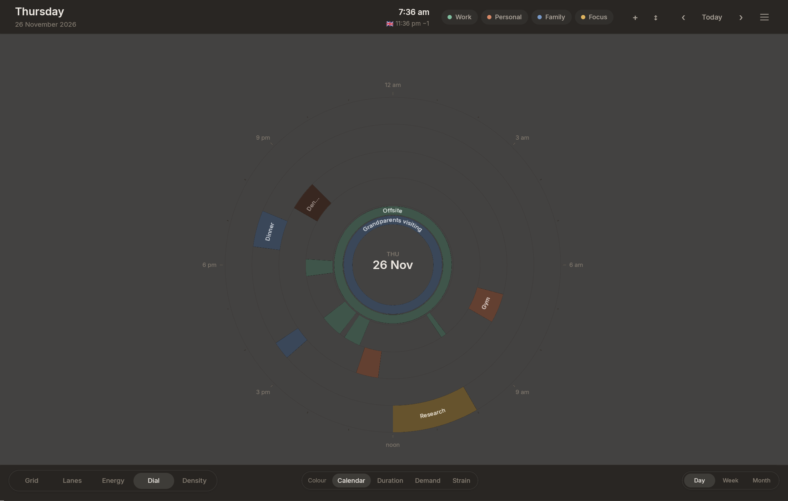
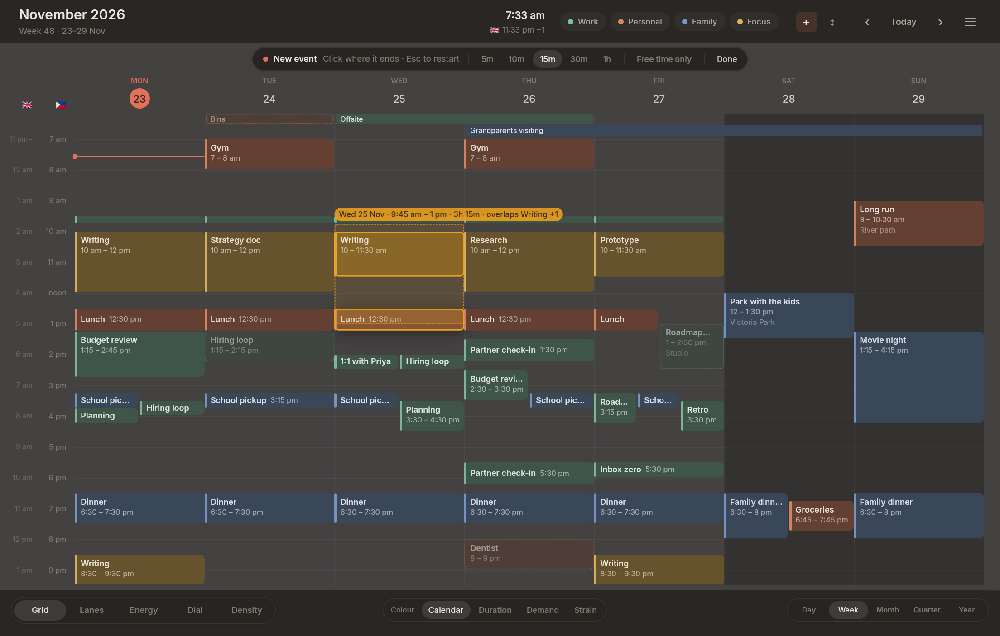

# calm

**A calendar built on a grammar of time.**

Most calendars are a handful of hard-coded screens: day, week, month. In calm, every view is a
small declarative spec (how days are arranged, what the axes mean, how overlaps resolve, what
mark each event becomes). Switching views *morphs* the same events from one layout to the next,
and you can edit the grammar to make views of your own.


<table>
<tr>
<td width="50%"></td>
<td width="50%"></td>
</tr>
<tr>
<td><b>Dial</b>: a day as a clock face, all-day events as rings.</td>
<td><b>Density</b>: a year at a glance, each day coloured by how booked it is.</td>
</tr>
</table>

## What's in it

- **Views you can change.** Grid, Lanes, Energy, Dial and Density are built in, all written in
  the same KDL grammar. Press `E` to edit the current one, or write your own in `calm.kdl`.
- **One continuous zoom** from a day to a year. Events stay events as long as there's room for
  them, then fold into coloured day cells.
- **Colour that means something.** Colour by calendar, hours booked, demand, strain or free time.
  You can also mix them: strength from a measure, hue from the calendar.
- **Your energy.** A sleep and circadian model (Åkerstedt & Folkard's three-process model) or a
  curve you draw. Demanding meetings drain it, and calm marks events that ask more than you'll
  have. It can run as a rail beside each day, alongside daylight.
- **Time zones.** Extra hour columns, flags for labels, and every event's time in each zone.
- **Google Calendar, offline.** Incremental sync into a local SQLite cache, so calm opens
  instantly and works on a plane. iCal feeds and files work too.
- **Deliberate editing.** Clicks and drags only ever select. To change things you enter a mode,
  and every change goes through an outbox you can review before it's sent.
- **Fast.** Built on [gpui](https://www.gpui.rs) (Zed's GPU UI framework), with spring animation
  throughout. No frames are drawn once everything settles.

## Editing



- **New (`N` or +):** click where an event starts, then where it ends.
- **Adjust (`A` or ↕):** drag an event to move it, or drag its ends to resize it.

Both modes snap to a step you pick (5 minutes to an hour). With **Free time only** on, they stay
out of busy time. With it off, overlaps show in amber and name what they'd clash with.

Everything works from the keyboard too: arrows move, `Enter` places, `Esc` steps back. Each move
offers Undo, and in auto mode nothing is sent until the Undo has had its moment.

Every change becomes a queued *op*. calm sends it with a conditional write, so if someone else
edited the same event, calm merges the two or shows you a conflict. It never overwrites their
change.

With `sync writes="review"`, changes are staged until you commit them in the changes panel (`O`).
Agents and scripts using the `calm event` CLI are always staged, so you see what they propose
before Google does.

The design: [docs/editing.md](docs/editing.md).

## Install

calm is a Nix flake (Linux for now):

```sh
nix run .                 # from a checkout: build and run
nix profile install .     # install `calm`
```

Or add it to NixOS or home-manager through the overlay:

```nix
inputs.calm.url = "path:/path/to/calm";       # or a git URL
nixpkgs.overlays = [ inputs.calm.overlays.default ];
home.packages = [ pkgs.calm ];                # or environment.systemPackages
```

The package wraps `calm` with the libraries gpui loads at runtime (Vulkan, Wayland, X11). Your
system needs to provide a working Vulkan driver.

From source:

```sh
devenv shell              # or `direnv allow` once
cargo run --release       # `--demo` for synthetic data
```

## Getting started

1. **Connect Google:** set up an OAuth client once ([docs/google.md](docs/google.md)), then run
   `calm google login you@gmail.com`.
2. **Point calm at it** in `~/.config/calm/calm.kdl`. Changes to this file apply as you save.

```kdl
source "Google" google="you@gmail.com"

// Names, colours and order for the chips in the top bar; secondary ones live in the ☰ menu.
calendar "you@gmail.com" label="Personal"
calendar "Work" color="slate" demand=0.6
calendar "Holidays in the United Kingdom" label="UK holidays" secondary=#true

zones "Asia/Manila" "Europe/London" {
    label "Europe/London" short="🇬🇧" long="London"
}

sync writes="review"        // stage edits until you commit them (default: "auto")
window opacity=0.8
```

With no sources configured, calm shows synthetic data around today.

`calm config check` validates the file, with file:line:col errors and "did you mean"
suggestions. `calm config dump` prints everything in effect, built-in views included, ready to
copy and change. Reference: [docs/config.md](docs/config.md).

## Keys

**Getting around**

| | |
|---|---|
| `1`–`9`, `Tab` | Switch view |
| Ctrl+scroll, `−` `=`, bottom right | Zoom: Day · Week · Month · Quarter · Year |
| `←` `→` | Previous / next at the current zoom |
| Scroll, Shift+scroll | Scroll hours (a day or week in view), otherwise time |
| Alt+scroll | Zoom the hour window |
| `F`, click the hour labels | Default hours ↔ the full 24 |
| `T` | Today |
| Click | An event's details · zoom into an overview cell |

**Looking**

| | |
|---|---|
| `C` · `B` · `V` | Colour measure · by calendar · composition (each view lists its own) |
| `G` | Day-span glyph in overview cells |
| `Z` | Extra time zones |
| `D` | Light / dark (follows the system by default) |
| `E` | Edit this view (and your energy settings) |
| `M`, ☰ | Menu: secondary calendars and actions |

**Changing**

| | |
|---|---|
| `N`, + | New event: click its start, then its end |
| `A`, ↕ | Adjust: drag to move, drag the ends to resize |
| In a mode | `[` `]` snap step · `F` free time only · arrows/`hjkl` move · `Shift` resizes · `Enter` places · `Esc` steps back |
| Click an event | Edit its title, date, times and location in the drawer |
| `Delete` | Delete the selected event, with Undo |
| `O` | Changes: staged, waiting, failed or in conflict; commit, revert, preview |
| `R` | Sync now |
| `?` | Help · `` ` `` frame stats |

## The command line

```sh
calm event list --day tomorrow                      # with IDs
calm event add "Focus" --start "tomorrow 9:00" --duration 90m
calm event move <id> --start 10:30                  # --all for a whole series
calm event delete <id>
calm outbox                                         # what's staged, waiting or stuck
calm commit --all                                   # asks at a terminal; --yes otherwise
calm discard <n>

calm config set Grid mark pill                      # the view editor's operations
calm config duplicate Grid · calm config reset "Grid copy"
```

Changes from the command line appear in the app at once, dimmed until they're committed and sent.

## Documentation

| | |
|---|---|
| [DESIGN.md](DESIGN.md) | The grammar of time: the idea behind calm |
| [docs/config.md](docs/config.md) | Everything `calm.kdl` can say: views, params, calendars, energy, themes, sync |
| [docs/editing.md](docs/editing.md) | Editing and write sync: the outbox, merging, review, modes |
| [docs/google.md](docs/google.md) | Connecting a Google account |
| [docs/storage-sync.md](docs/storage-sync.md) | The offline cache and read sync |
| [docs/roadmap.md](docs/roadmap.md) | What's next |
| [docs/gpui-spike.md](docs/gpui-spike.md) | Why gpui |

## Development

| Flag | |
|---|---|
| `--lens N`, `--zoom STOP`, `--theme dark\|light`, `--offset DAYS`, `--zones A,B` | Start state |
| `--color MEASURE[:scale\|:calendar\|:COMPOSE]`, `--span` | Start colouring, day-span glyph |
| `--edit`, `--menu`, `--changes`, `--controls`, `--picker N`, `--mode new\|adjust` | Open a panel or mode |
| `--translucent`, `--opacity X`, `--blur` | Translucent window |
| `--still` | Springs settle in one frame (screenshots) |
| `--hover x,y`, `--select x,y` | Scripted pointer once the window settles; in a mode, the press and the pointer |
| `--demo` | Synthetic data even when sources are configured |
| `--cycle` · `--bench` | Cycle views · scripted tour printing frame and CPU percentiles (`CALM_MULT`, `CALM_SKIP=decor,marks,labels,chrome`) |

Where things live:

- `src/spec.rs`: the grammar: channels, params, and how values resolve.
- `src/viewconf.rs`, `assets/views.kdl`: the KDL loader and the built-in views.
- `src/layout.rs`: collision and projection into in-cell coordinates. Every mark belongs to a day
  cell, so zooming and scrolling never relayout.
- `src/view/`: the app. `mod.rs` holds springs, input and the render loop; `arrange.rs` the day
  arrangement (strip → lines → bands); `scene.rs` marks, morphs, labels and paint; `chrome.rs` the
  bars, drawer and panels; `editing.rs` and `modes.rs` editing.
- `src/energy.rs`, `src/sun.rs`: the energy model and daylight.
- `src/sync/`: the cache, Google and iCal sync, and the outbox.
- `patches/gpui`: gpui 0.2.2 plus `Window::paint_glyph_rotated`, for text along arcs.
- `assets/fonts`: Inter (OFL), subset to Latin.
