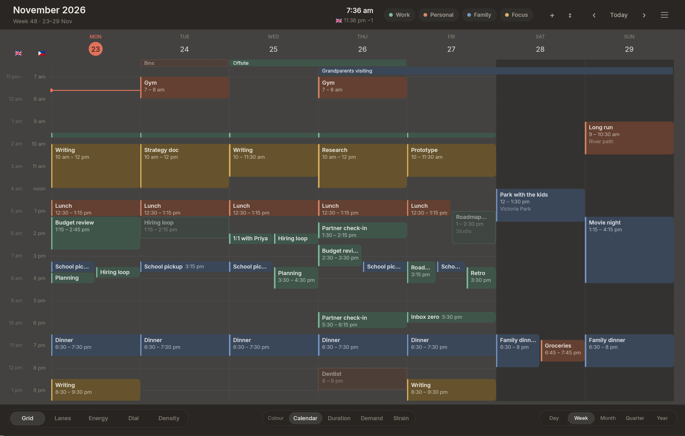
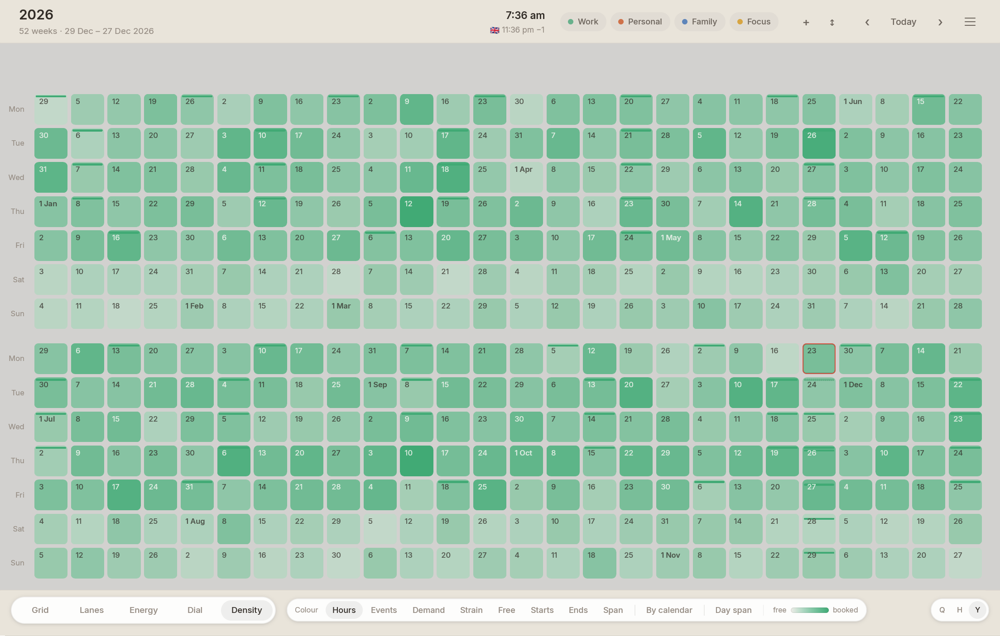
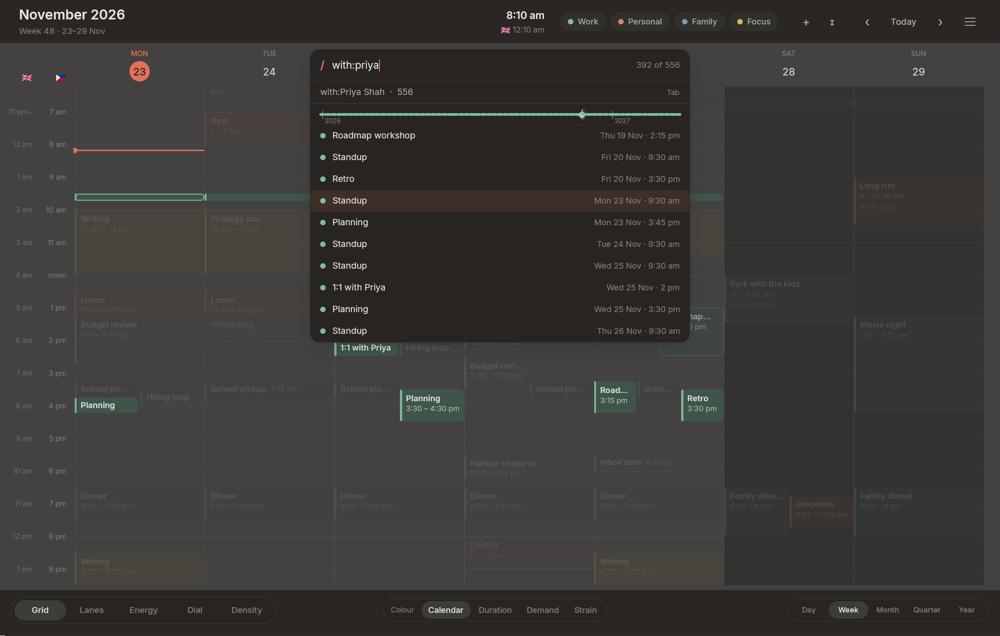
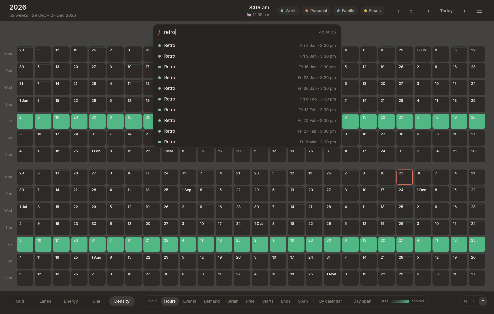

# calm

**A calendar that's fast, powerful and pleasant to use.**

Calendars are where your days go, yet most of them are slow web pages with three hard-coded
screens. calm is a native desktop calendar for Google Calendar. It opens instantly, works
offline, and every interaction is animated at the speed of your display. It shows your time the
way you want to see it, from a single day to the whole year in one continuous zoom, and it never
changes your calendar by accident.



<table>
<tr>
<td width="50%"></td>
<td width="50%"></td>
</tr>
<tr>
<td><b>Dial</b>: a day as a clock face, all-day events as rings.</td>
<td><b>Density</b>: a year at a glance, each day coloured by how booked it is.</td>
</tr>
</table>

## Fast

- **Instant, and offline.** Google calendars sync incrementally into a local SQLite cache, so
  calm opens straight away and works on a plane. iCal feeds and files work too.
- **Native and GPU-drawn.** Built in Rust on [gpui](https://www.gpui.rs), Zed's UI framework.
  Every change of view or zoom is a spring animation, and nothing is drawn once everything settles.
- **Keyboard first, vim-flavoured.** `/` searches as you type and `n` / `N` step through the
  matches; `:31` goes to the 31st; `hjkl` move. You can schedule an event without touching the
  mouse and nudge the selected one by a step or a day. `?` lists every key.

## Powerful

- **A grammar of time.** Most calendars are a handful of fixed screens. In calm, every view is a
  small declarative spec: how days are arranged, what the axes mean, how overlaps resolve, and
  what mark each event becomes. Switching views *morphs* the same events from one layout to the
  next. Grid, Lanes, Energy, Dial and Density are built in, all written in the same KDL grammar;
  press `E` to edit the one you're looking at, or write your own in `calm.kdl`. The idea is in
  [DESIGN.md](DESIGN.md).
- **One continuous zoom** from a day to a year. Events stay events while there's room for them,
  then fold into coloured day cells.
- **Colour that means something.** Colour by calendar, hours booked, demand, strain or free time,
  or mix them: strength from a measure, hue from the calendar.
- **Your energy.** A sleep and circadian model (Åkerstedt & Folkard's three-process model), or a
  curve you draw. Demanding meetings drain it, and calm marks events that ask more than you'll
  have. It can run as a rail beside each day, alongside daylight.
- **Search everything.** Titles, people (`with:sam`), calendars, places and series. Matches stay
  bright and everything else dims, in every view: at year zoom, only the matching days light up.
  A thin timeline shows every match across the calendar; click one to go there.
- **Time zones.** Extra hour columns with flags for labels, and every event's time in each zone.
- **Scriptable.** A command line for events and config, so agents and scripts can propose
  changes for you to review.

## Pleasant

- **Calm by default.** Quiet colours, light and dark themes (or your own), and a translucent
  window if you like.
- **No accidental edits.** Clicks and drags only ever select. To change things you enter a mode,
  and every change goes through an outbox you can review before it's sent, with Undo.
- **Clashes at a glance.** An event's details list what it overlaps: other meetings in red, and
  the all-day events it falls on (a trip, a holiday) in orange, since those aren't double
  bookings.
- **Live config.** One file, applied as you save it, with clear errors when something's wrong.

## Search and jump

<table>
<tr>
<td width="50%"></td>
<td width="50%"></td>
</tr>
<tr>
<td><code>/with:priya</code>: every event with Priya, the rest dimmed.</td>
<td>The same search at year zoom: <code>/retro</code> lights up the Fridays.</td>
</tr>
</table>

Press `/` and start typing, as in vim. calm jumps to the next match as you type and dims
everything else. That works in every view, so at year zoom the matching days light up.

- **Search more than titles:** `with:sam`, `in:work`, `at:studio`, `series:standup`,
  `is:tentative`. As you type `with:`, calm offers the people in your calendar, and Tab completes.
- **Move between matches:** the list under the field follows you (↑ ↓), and a thin timeline shows
  every match across the whole calendar; click it to go there. `Enter` lands on the match, then
  `n` and `N` step through the rest. `Esc` puts the view back where it was.
- **Go to a date with `:`**, read from the month you're looking at: `:31`, `:12-31`,
  `:2027-03-04`, `:dec 24`, `:mon`, `:+2w`, `:today`. The field shows where it'll land before
  you press Enter.

`?` shows every key, grouped, along with the ones the current view adds.

## Editing


- **New (`S` for schedule, or +):** click where an event starts, then where it ends.
- **Adjust (`A` or ↕):** drag an event to move it, or drag its ends to resize it.

Both modes snap to a step you pick (5 minutes to an hour). With **Free time only** on, they stay
out of busy time. With it off, overlaps show in amber and name what they'd clash with.

Everything works from the keyboard too: arrows move, `Enter` places, `Esc` steps back. Each move
offers Undo, and in auto mode nothing is sent until the Undo has had its moment.

Every change becomes a queued *op*. calm sends it with a conditional write, so if someone else
edited the same event, calm merges the two or shows you a conflict. It never overwrites their
change.

With `sync writes="review"`, changes are staged until you commit them in the changes panel (`O`).
Agents and scripts using the `calm event` CLI are always staged, so you see what they propose
before Google does.

The design: [docs/editing.md](docs/editing.md).

## Planned

Some of what's coming has no equivalent in other calendars yet:

- **Rules.** Declarative rules that read an event (its title, guests, calendar, time) and derive
  things about it: a tag, how demanding it is, which project it belongs to. Their outputs become
  channels the grammar can use, so a view can colour by project or hide everything tagged
  "optional". Rules apply in order and explain themselves: the drawer shows which ones fired.
  They use a small expression language, not embedded scripting.
- **Filters as configurable as views.** Today you can only show or hide calendars. Filters will
  match on anything about an event: its title, people, series, location, status, time, or a tag
  from your rules. They're declared in `calm.kdl` like views, toggled from the top bar like the
  calendar chips (which become one built-in filter among many), and views can bring filters of
  their own. From an event's details you'll be able to say "only this series" or "only events
  with Sam". Non-matching events can hide or just dim, and they morph out like everything else.
- **Overrun risk.** Some meetings always run long. Rules will estimate the risk from what's known:
  many guests, a series that habitually overruns, words like "workshop", no gap before the next
  thing. calm then draws a faint tail past the event's end, flags where the tail would run into the
  next event, and adds the extra strain to your energy curve.
- **Detail around now.** One view that shows today in full, this week as lists and the rest of
  the month as coloured days, coarsening smoothly into the past and future. It would be part of
  the grammar, not a separate mode.
- **A command palette and a vim layer.** Remappable keys for everything, the `:` line growing into
  a command line with fuzzy completion (`:view dial`, `:zoom year`), and counts and `gg`/`G`.

Closer to hand:

- Editing a recurring event: "this event, or all events?" when you move one occurrence, and later
  "this and following".
- A "notify guests?" prompt when you move a meeting, instead of the drawer's setting.
- Picking events from the keyboard, so every edit works without the mouse.
- `Ctrl+Z` and redo for any change, from calm's history of changes (today, Undo lives in the toast).
- Replying to invitations, and converting events between all-day and timed.
- More calendar services through the same outbox: CalDAV first (iCloud, Fastmail).
- Hiding boilerplate notes repeated across unrelated events (meeting-link footers, Google's
  auto-event notice).
- macOS packaging, and a home-manager module for calm's config.

The longer list, with what's done: [docs/roadmap.md](docs/roadmap.md).

## Install

calm is a Nix flake (Linux for now):

```sh
nix run .                 # from a checkout: build and run
nix profile install .     # install `calm`
```

Or add it to NixOS or home-manager through the overlay:

```nix
inputs.calm.url = "path:/path/to/calm";       # or a git URL
nixpkgs.overlays = [ inputs.calm.overlays.default ];
home.packages = [ pkgs.calm ];                # or environment.systemPackages
```

The package wraps `calm` with the libraries gpui loads at runtime (Vulkan, Wayland, X11). Your
system needs to provide a working Vulkan driver.

From source:

```sh
devenv shell              # or `direnv allow` once
cargo run --release       # `--demo` for synthetic data
```

## Getting started

1. **Connect Google:** set up an OAuth client once ([docs/google.md](docs/google.md)), then run
   `calm google login you@gmail.com`.
2. **Point calm at it** in `~/.config/calm/calm.kdl`. Changes to this file apply as you save.

```kdl
source "Google" google="you@gmail.com"

// Names, colours and order for the chips in the top bar; secondary ones live in the ☰ menu.
calendar "you@gmail.com" label="Personal"
calendar "Work" color="slate" demand=0.6
calendar "Holidays in the United Kingdom" label="UK holidays" secondary=#true

zones "Asia/Manila" "Europe/London" {
    label "Europe/London" short="🇬🇧" long="London"
}

sync writes="review"        // stage edits until you commit them (default: "auto")
window opacity=0.8
```

With no sources configured, calm shows synthetic data around today.

`calm config check` validates the file, with file:line:col errors and "did you mean"
suggestions. `calm config dump` prints everything in effect, built-in views included, ready to
copy and change. Reference: [docs/config.md](docs/config.md).

## Keys

**Getting around**

| | |
|---|---|
| `1`–`9`, `Tab` | Switch view |
| Ctrl+scroll, `−` `=`, bottom right | Zoom: Day · Week · Month · Quarter · Year |
| `←` `→` | Previous / next at the current zoom |
| Scroll, Shift+scroll | Scroll hours (a day or week in view), otherwise time |
| Alt+scroll | Zoom the hour window |
| `F`, click the hour labels | Default hours ↔ the full 24 |
| `T` | Today |
| `/` | Search: type a title, or `with:` `in:` `at:` `series:` `is:`; ↑ ↓ through matches, Tab completes, Enter goes there, Esc goes back |
| `n` `N` | Next / previous match, after a search |
| `:` | Jump to a date: `:31`, `:12-31`, `:2027-03-04`, `:dec 24`, `:mon`, `:+2w`, `:today` |
| Click | An event's details · zoom into an overview cell |

**Looking**

| | |
|---|---|
| `C` · `B` · `V` | Colour measure · by calendar · composition (each view lists its own) |
| `G` | Day-span glyph in overview cells |
| `Z` | Extra time zones |
| `D` | Light / dark (follows the system by default) |
| `E` | Edit this view (and your energy settings) |
| `M`, ☰ | Menu: secondary calendars and actions |

**Changing**

| | |
|---|---|
| `S`, + | Schedule (new event): click its start, then its end |
| `A`, ↕ | Adjust: drag to move, drag the ends to resize |
| In a mode | `[` `]` snap step · `F` free time only · arrows/`hjkl` move · `Shift` resizes · `Enter` places · `Esc` steps back |
| Click an event | Edit its title, date, times and location in the drawer |
| `Delete` | Delete the selected event, with Undo |
| `O` | Changes: staged, waiting, failed or in conflict; commit, revert, preview |
| `R` | Sync now |
| `?` | Help · `` ` `` frame stats |

## The command line

```sh
calm event list --day tomorrow                      # with IDs
calm event add "Focus" --start "tomorrow 9:00" --duration 90m
calm event move <id> --start 10:30                  # --all for a whole series
calm event delete <id>
calm outbox                                         # what's staged, waiting or stuck
calm commit --all                                   # asks at a terminal; --yes otherwise
calm discard <n>

calm config set Grid mark pill                      # the view editor's operations
calm config duplicate Grid · calm config reset "Grid copy"
```

Changes from the command line appear in the app at once, dimmed until they're committed and sent.

## Documentation

| | |
|---|---|
| [DESIGN.md](DESIGN.md) | The grammar of time: the idea behind calm |
| [docs/config.md](docs/config.md) | Everything `calm.kdl` can say: views, params, calendars, energy, themes, sync |
| [docs/editing.md](docs/editing.md) | Editing and write sync: the outbox, merging, review, modes |
| [docs/google.md](docs/google.md) | Connecting a Google account |
| [docs/storage-sync.md](docs/storage-sync.md) | The offline cache and read sync |
| [docs/roadmap.md](docs/roadmap.md) | What's next |
| [docs/gpui-spike.md](docs/gpui-spike.md) | Why gpui |

## Development

| Flag | |
|---|---|
| `--lens N`, `--zoom STOP`, `--theme dark\|light`, `--offset DAYS`, `--zones A,B` | Start state |
| `--color MEASURE[:scale\|:calendar\|:COMPOSE]`, `--span` | Start colouring, day-span glyph |
| `--edit`, `--menu`, `--changes`, `--controls`, `--help-card`, `--picker N`, `--mode new\|adjust`, `--search Q`, `--jump D` | Open a panel, mode or prompt |
| `--translucent`, `--opacity X`, `--blur` | Translucent window |
| `--still` | Springs settle in one frame (screenshots) |
| `--hover x,y`, `--select x,y` | Scripted pointer once the window settles; in a mode, the press and the pointer |
| `--demo` | Synthetic data even when sources are configured |
| `--cycle` · `--bench` | Cycle views · scripted tour printing frame and CPU percentiles (`CALM_MULT`, `CALM_SKIP=decor,marks,labels,chrome`) |

Where things live:

- `src/spec.rs`: the grammar: channels, params, and how values resolve.
- `src/viewconf.rs`, `assets/views.kdl`: the KDL loader and the built-in views.
- `src/layout.rs`: collision and projection into in-cell coordinates. Every mark belongs to a day
  cell, so zooming and scrolling never relayout.
- `src/view/`: the app. `mod.rs` holds springs, input and the render loop; `arrange.rs` the day
  arrangement (strip → lines → bands); `scene.rs` marks, morphs, labels and paint; `chrome.rs` the
  bars, drawer and panels; `editing.rs` and `modes.rs` editing.
- `src/energy.rs`, `src/sun.rs`: the energy model and daylight.
- `src/sync/`: the cache, Google and iCal sync, and the outbox.
- `patches/gpui`: gpui 0.2.2 plus `Window::paint_glyph_rotated`, for text along arcs.
- `assets/fonts`: Inter (OFL), subset to Latin.
